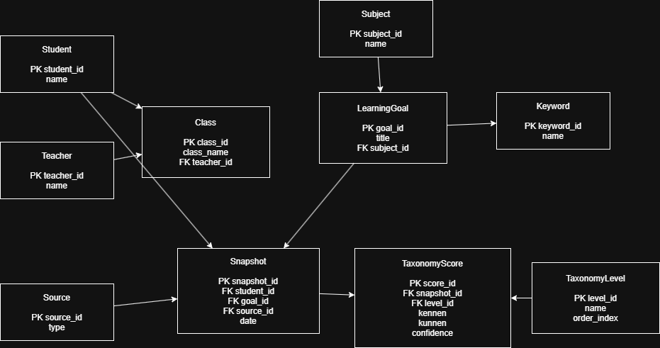
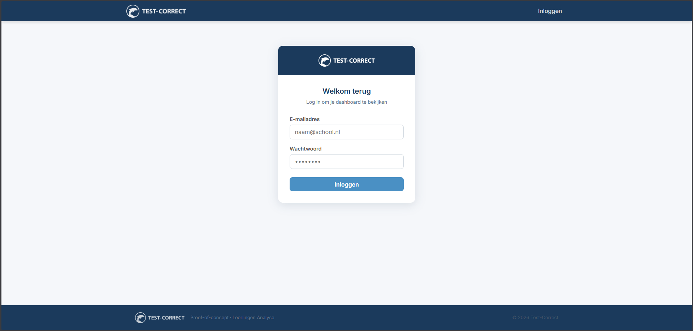
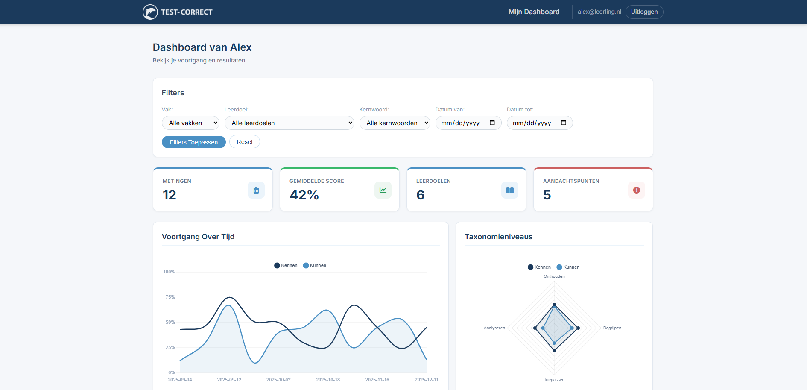
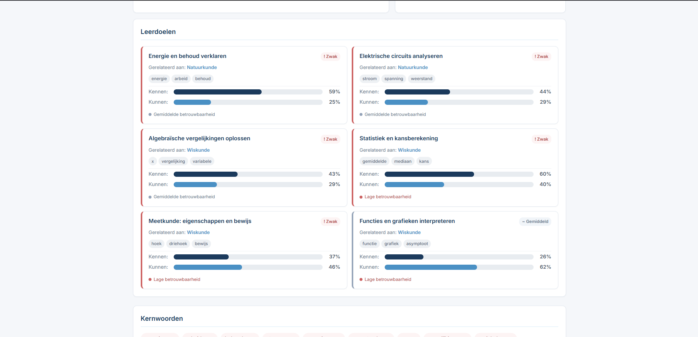
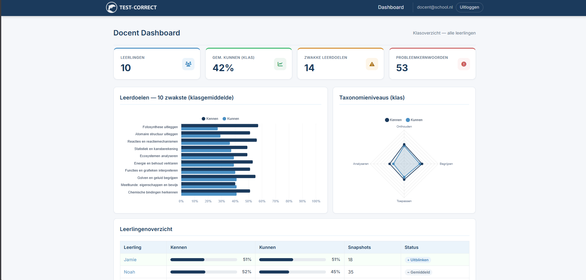
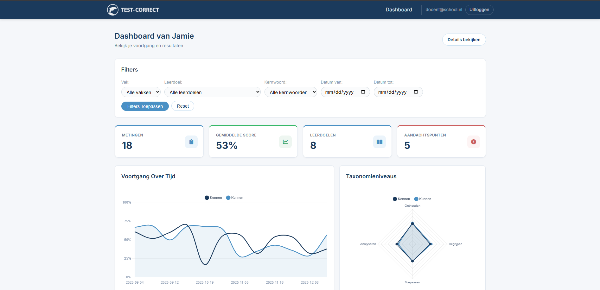
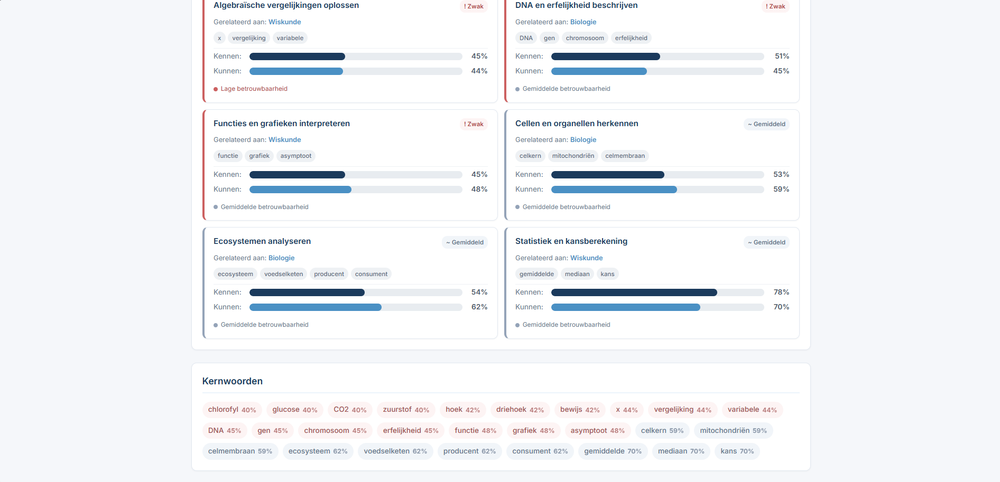
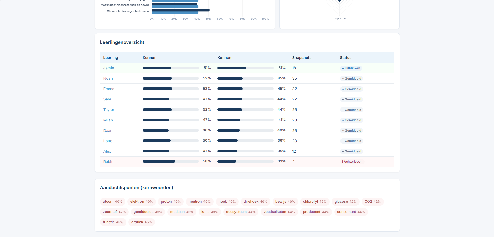
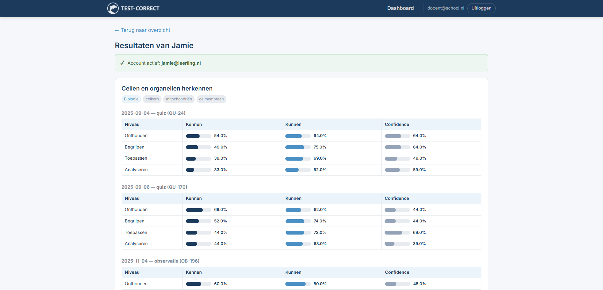

# Installatie-instructie

Deze README bevat de minimale installatie-informatie die volgens de casus vereist is.

## 1. Vereiste software
- Python 3.11 of hoger
- pip
- Windows PowerShell (voor de commando's hieronder)

## 2. Dependencies installeren
1. Maak (optioneel, maar aanbevolen) een virtual environment aan:

```powershell
python -m venv .venv
```

2. Activeer de virtual environment:

```powershell
.\.venv\Scripts\Activate.ps1
```

3. Installeer dependencies:

```powershell
pip install -r requirements.txt
```

## 3. Database aanmaken / initialiseren
Deze applicatie gebruikt SQLite. De database wordt automatisch aangemaakt bij het starten van de app.

Pad databasebestand:
- `data/app.db`

### Flask data import
Initialiseer en vul de database met voorbeelddata via Flask CLI:

```powershell
python -m flask --app run.py import-data data/data-sample-small.json
```

Bij de import worden klassen automatisch aangemaakt en gekoppeld:
- Als je JSON een klas bevat (`class.name`, `class`, `student.class`, `student.className` of `student.group`), dan wordt die klas aangemaakt/gebruikt.
- Als er geen klas in de JSON staat, dan wordt de leerling automatisch gekoppeld aan `Onbekende klas`.

Maak testaccounts voor leerlingen + docent aan:

```powershell
python -m flask --app run.py seed-users
```

## Inloggen
Docent login:
- E-mail: `docent@school.nl`
- Wachtwoord: `docent123`

Leerling logins:
Zo maak je een leerlingaccount aan:
1. Log in als docent met `docent@school.nl` en `docent123`.
2. Open het docentdashboard en kies een leerling.
3. Open de leerlingdetailpagina.
4. Vul e-mailadres en wachtwoord in bij Account aanmaken.
5. Klik op Account aanmaken.

## Klasbeheer
- Log in als docent en ga naar het docentdashboard.
- Maak bovenaan een nieuwe klas aan (bijv. `H2A`).
- Koppel leerlingen aan een klas via de nieuwe kolom `Klas` in de leerlingenlijst.
- Filter het dashboard op een specifieke klas via `Geselecteerde klas`.

## 4. Applicatie starten
Start de applicatie met:

```powershell
python run.py
```

## ERD


Dit is de ERD diagram.

## Screenshots + toelichting

### 1. Loginpagina


Inlogpagina voor docent en leerling; na inloggen wordt automatisch doorgestuurd naar het juiste dashboard op basis van de gebruikersrol.

### 2. Leerling dashboard (overzicht)


Hoofdscherm van de leerling met filters, statistieken en grafieken voor voortgang over tijd en taxonomieniveaus.

### 3. Leerling dashboard (leerdoelen en kernwoorden)


Overzicht van leerdoelen met kennen/kunnen scores en onderaan aandachtspunten per kernwoord.

### 4. Docent dashboard (klassikaal)


Klassikaal docentdashboard met kerncijfers en grafieken voor zwakke leerdoelen en taxonomieniveaus.

### 5. Docent dashboard (leerling als dashboard)


Docentweergave van een individuele leerling in dashboardvorm met filters, trends en taxonomievisualisatie.

### 6. Docent dashboard (leerlingoverzicht tabel + kernwoorden)


Tabel met alle leerlingen, gemiddelde scores, snapshots en status, met daaronder klassikale aandachtspunten op kernwoorden.

### 7. Docent leerlingenoverzicht


Overzichtspagina waarin de docent leerlingen kan selecteren en snel naar leerlingdetails kan navigeren.

### 8. Docent leerling detail


Detailpagina per leerling met resultaten per leerdoel en meetmoment, inclusief tabellen met kennen, kunnen en confidence per taxonomieniveau.

## Gebruikte bronnen (Yavuz)

Voor JavaScript:
- https://www.w3schools.com/js/
- https://devdocs.io/javascript/

Voor AJAX:
- https://www.w3schools.com/js/js_ajax_intro.asp
- https://stackoverflow.com/questions/6009206/what-is-ajax-and-how-does-it-work
- https://api.jquery.com/jQuery.ajax/
- https://www.tutorialspoint.com/javascript/javascript_ajax.htm
- https://www.geeksforgeeks.org/jquery/what-is-ajax/

Voor CSS:
- https://www.w3schools.com/css/

Voor Python:
- Werkplaat 2 (oude code van project)

-----------------------------------------------

## Gebruikte bronnen (Slava)

### JavaScript / Animaties
- Werkplaats jaar 2 (eigen opgebouwde kennis uit voorgaande projecten)
- [Anime.js](https://animejs.com/) — gebruikt voor UI-animaties en visuele overgangen

### CSS / Design
- Eigen mockups als ontwerpleidraad
- [Claude (Anthropic)](https://claude.ai) — AI-tool ingezet voor het genereren en verfijnen van CSS-code op basis van zelfgemaakte mockups; code telkens handmatig beoordeeld en aangepast

### Beveiliging
- [Snyk AI](https://snyk.io) — gebruikt voor statische code-analyse en het opsporen van beveiligingskwetsbaarheden

### Overig
- Diverse AI-tools ingezet ter ondersteuning van het ontwikkelproces, met als doel inzicht te krijgen in de mogelijkheden en werkwijze van AI bij softwareontwikkeling
- Wat hierboven niet expliciet is benoemd, is gebaseerd op kennis en ervaring opgedaan tijdens de opleiding — als tweedejaars student kon ik voor veel onderdelen terugvallen op eerder geleerde stof en eigen inzicht
