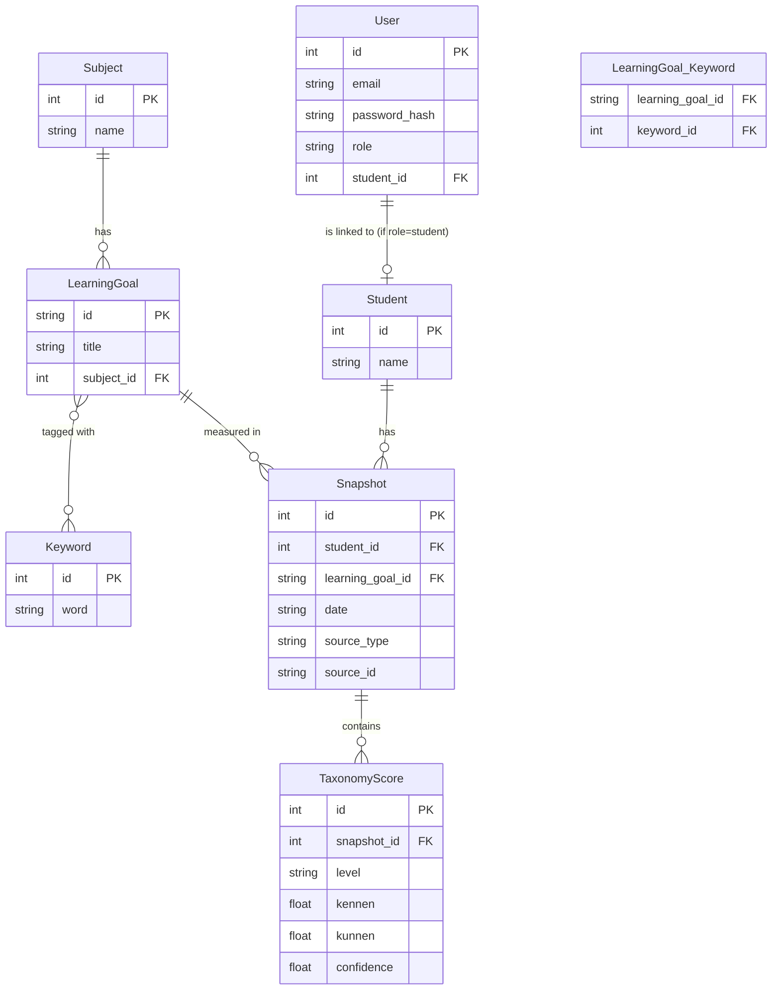

# Test Correct Leerlingen Analyse

Dit project is een proof-of-concept (MVP) webapplicatie voor het inzichtelijk maken van leerlingresultaten uit Test Correct. Het biedt dashboards voor zowel leerlingen als docenten, waarop voortgang, sterke en zwakke punten per leerdoel, taxonomieniveau en kernwoord geanalyseerd kunnen worden.

## Functionaliteiten

- **Leerlingen dashboard:** Inzicht in eigen voortgang over tijd (grafiek), sterke en zwakke punten per leerdoel en prestaties per taxonomieniveau (radardiagram).
- **Docenten dashboard:** Klassikaal overzicht met gemiddelde scores, zwakke punten en de mogelijkheid om in te zoomen op specifieke leerlingen.
- **Filters:** Data kan worden gefilterd op vak, leerdoel, kernwoord en datumbereik met behulp van AJAX (zonder pagina-herlaad).
- **Authenticatie:** Simpele login met rolverdeling (leerling vs. docent).

## Architectuur & API

De applicatie is gebouwd met **Python (Flask)** voor de backend en puur **HTML/CSS/JS** voor de frontend. 
Voor de interactieve grafieken wordt gebruikgemaakt van **Chart.js**. 
Data wordt opgeslagen in een lokale **SQLite** database (`app.db`), benaderd via SQLAlchemy (ORM).

### REST API Endpoints

De frontend communiceert asynchroon met de backend via de volgende API-endpoints:
- `GET /api/students` - Geeft een lijst van alle leerlingen (alleen docent).
- `GET /api/students/<id>` - Geeft detailgegevens van een leerling, inclusief gefilterde snapshots en leerdoelen.
- `GET /api/subjects` - Haalt beschikbare vakken op.
- `GET /api/class-overview` - Geeft een geaggregeerd overzicht van de hele klas terug (alleen docent).

## Entity Relationship Diagram (ERD)

Hieronder staat het datamodel van de applicatie:



## Installatie-instructies

Volg deze stappen om het project lokaal te draaien.

### 1. Vereisten
- Python 3.8 of nieuwer.
- Een virtuele omgeving (`venv`) wordt sterk aangeraden.

### 2. Dependencies installeren
Maak een virtuele omgeving aan en activeer deze:
```bash
python -m venv .venv
# Windows:
.venv\Scripts\activate
# Mac/Linux:
source .venv/bin/activate
```

Installeer de benodigde packages:
```bash
pip install -r requirements.txt
```

### 3. Database initialiseren en data importeren
De applicatie vereist een actieve SQLite database (`app.db`). Om de database aan te maken, basale accounts (docent) te genereren en de test-data uit `data-sample-small.json` te importeren, draai je:
```bash
python run.py --init-db
```
*(Dit wist een eventueel bestaande database en maakt hem opnieuw aan).*

### 4. Applicatie starten
Zodra de database is geïnitialiseerd, kun je de server starten:
```bash
python run.py
```
De applicatie is nu bereikbaar op [http://localhost:5000](http://localhost:5000).

### Inloggen
Tijdens de `--init-db` stap wordt er standaard een docent-account aangemaakt:
- **E-mail:** `docent@test-correct.nl`
- **Wachtwoord:** `testcorrect`

*(Leerling-accounts kunnen vanuit het docentendashboard worden aangemaakt bij de details van een leerling, of direct via de shell gescript worden).*
